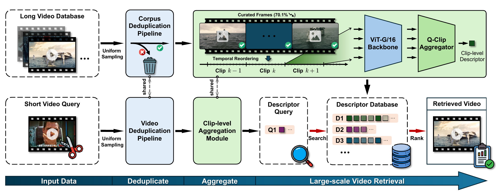
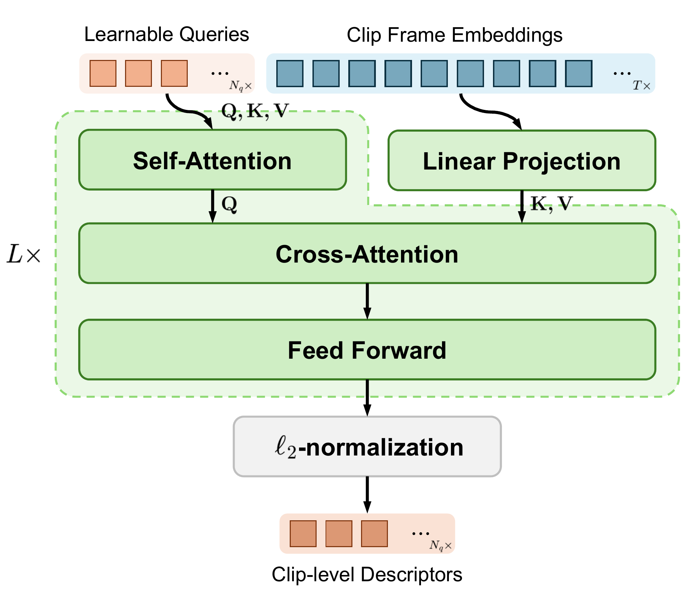

<div align="center">

# 🎞️ Q-Clip

### Deduplicate Before You Aggregate:<br>Efficient Clip Encoding for Scalable Video Retrieval

*Compressing frame embeddings into compact clip descriptors with learnable queries.*

Jiajun Dong · Yuan Liang · Gengyuan Liu<br>
**ACM Multimedia 2026**

[](https://doi.org/10.1145/3767308.3835060)
[](qclip/models/qclip.py)
[](docs/REPRODUCING.md)

**English** | [简体中文](README.zh-CN.md)

[Getting started](#getting-started) · [Inference](#inference-with-a-checkpoint) · [Pipeline guide](docs/REPRODUCING.md) · [Citation](#citation)



</div>

---

## How it works

The pipeline samples and deduplicates frames, extracts frame features, and aggregates each clip into a compact descriptor. Database and query videos share the encoder; retrieval uses a FAISS index followed by video-level score aggregation.

<p align="center">
  
</p>

In [`qclip/models/qclip.py`](qclip/models/qclip.py), learnable queries attend to frame embeddings through decoder blocks. The model returns descriptors of shape `[B, Nq, D]` and attention weights `[B, Nq, T]`. The `dedup_tsa256` configuration uses one query and two decoder blocks; frames have no positional encodings. Normalize the descriptors before cosine-similarity retrieval.

## Getting started

Use **Python 3.11**. From the repository root, install the dependencies needed for the aggregation model:

```bash
git clone https://github.com/ChrisDong-THU/Q-Clip.git
cd Q-Clip
python -m venv .venv
source .venv/bin/activate
python -m pip install --upgrade pip
python -m pip install torch==2.7.1 torchvision==0.22.1 \
  lightning==2.5.1 timm==1.0.11 omegaconf numpy tqdm
```

The commands above use a Linux shell. For GPU inference, use a PyTorch build compatible with your CUDA environment. The full [`requirements.txt`](requirements.txt) additionally includes a Linux GPU FAISS wheel, a local CUDA extension, and infrastructure dependencies; see the [pipeline guide](docs/REPRODUCING.md) before installing the full stack.

### Try the model interface

This CPU example uses **random weights and synthetic frame embeddings** to demonstrate the interface. Retrieval requires trained weights and features from the matching frame encoder.

```python
import torch
import torch.nn.functional as F
from omegaconf import OmegaConf
from qclip.models import QClip

config = OmegaConf.load("qclip/configs/dedup_tsa256.yaml")
model = QClip(**config.model).eval()

# B videos, T frames per clip, 1536-dimensional frame features.
frames = torch.randn(2, 256, 1536)
with torch.inference_mode():
    descriptors, attention = model(frames)
    descriptors = F.normalize(descriptors, dim=-1)

print(descriptors.shape)  # torch.Size([2, 1, 1536])
print(attention.shape)    # torch.Size([2, 1, 256])
```

## Inference with a checkpoint

Prepare frame embeddings as `<video_id>.npy` arrays of shape `[num_frames, 1536]` and a task JSONL file. Each task identifies a video by the stem of `jsonl_path`:

```json
{"jsonl_path": "/path/to/meta/video_001.jsonl"}
```

With `/path/to/frame_embeddings/video_001.npy` and a checkpoint directory containing `config.yaml` and `step=20000.ckpt`, run:

```bash
python -m data.infer.infer_qclip \
  --task-jsonl /path/to/tasks.jsonl \
  --frame-emb-dir /path/to/frame_embeddings \
  --ckpt-dir /path/to/checkpoint \
  --output-dir /path/to/clip_embeddings \
  --clip-len 256 --batch-size 32
```

This entry point requires CUDA. It writes normalized descriptors to `video_001.npy` and the corresponding `entity_id`, `clip_id`, and `slot_id` records to `video_001.jsonl`. For preprocessing, training, index construction, and evaluation, follow the [pipeline guide](docs/REPRODUCING.md).

**Available assets:** this repository contains code and configurations; pretrained checkpoints, frame-encoder weights, and Toutiao-TVVR data are not bundled. The paper reports DINOv2 experiments, while this code snapshot includes DINOv3 frame-extraction utilities. Match the frame encoder, feature dimension, and aggregation checkpoint when using the pipeline.

## Repository layout

| Path | Purpose |
| --- | --- |
| [`qclip/`](qclip/) | Q-Clip model, InfoNCE / KoLeo losses, training, and configurations |
| [`data/`](data/) | Frame preprocessing, feature extraction, and WebDataset packing |
| [`dinov3/`](dinov3/) | Frame-backbone implementation and training utilities |
| [`vrl/`](vrl/) | VRL baseline |
| [`eval/`](eval/) | FAISS retrieval and recall evaluation |
| [`tools/`](tools/) | Task generation and embedding-shard merging |
| [`scripts/`](scripts/) | Cluster launch examples; adapt paths and environment settings |
| [`service/`](service/) | Inference-service utilities |

## Citation

```bibtex
@inproceedings{dong2026qclip,
  title     = {Deduplicate Before You Aggregate: Efficient Clip Encoding for Scalable Video Retrieval},
  author    = {Dong, Jiajun and Liang, Yuan and Liu, Gengyuan},
  booktitle = {Proceedings of the 34th ACM International Conference on Multimedia},
  year      = {2026},
  doi       = {10.1145/3767308.3835060},
  url       = {https://doi.org/10.1145/3767308.3835060}
}
```

Questions and bug reports: [GitHub Issues](https://github.com/ChrisDong-THU/Q-Clip/issues). Figure attribution is recorded in [`docs/assets/README.md`](docs/assets/README.md).
