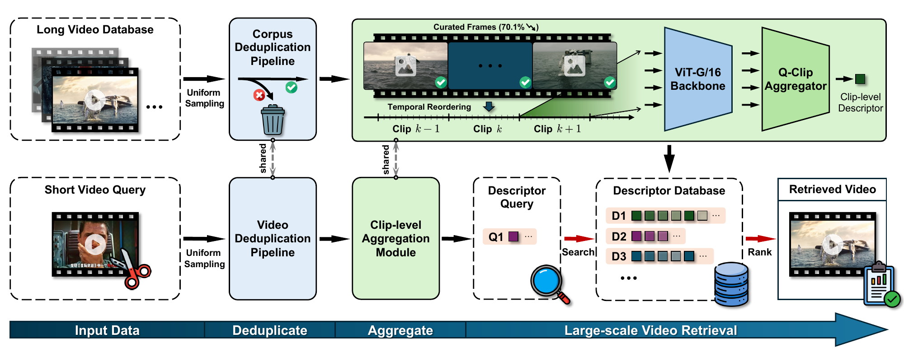
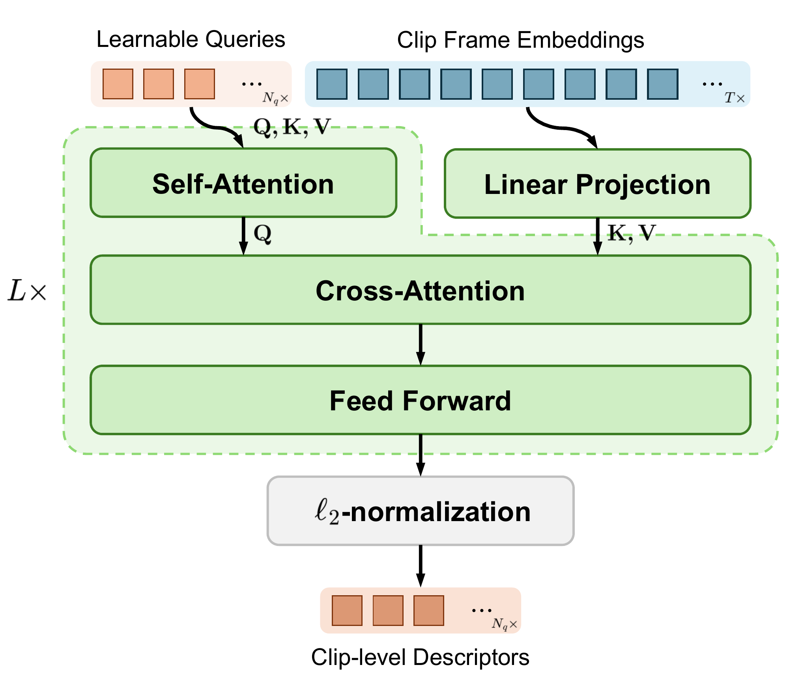

<div align="center">

# 🎞️ Q-Clip

[](https://doi.org/10.1145/3767308.3835060)
[](qclip/models/qclip.py)
[](docs/REPRODUCING.zh-CN.md)

[English](README.md) | **简体中文**

[快速开始](#快速开始) · [使用权重推理](#使用权重推理) · [完整流水线指南](docs/REPRODUCING.zh-CN.md) · [引用](#引用)



</div>

---

## 工作原理

流水线先抽帧、去重并提取帧特征，再将每个片段聚合为紧凑描述子。数据库与查询视频共用编码器；检索使用 FAISS 索引，再按视频聚合得分。

<p align="center">
  
</p>

[`qclip/models/qclip.py`](qclip/models/qclip.py) 中，可学习查询通过解码器模块对帧特征进行注意力聚合。模型返回 `[B, Nq, D]` 的描述子和 `[B, Nq, T]` 的注意力权重。`dedup_tsa256` 配置使用一个查询、两层解码器，帧特征不添加位置编码。用于余弦相似度检索前，应对描述子做归一化。

## 快速开始

使用 **Python 3.11**。在仓库根目录安装聚合模型所需依赖：

```bash
git clone https://github.com/ChrisDong-THU/Q-Clip.git
cd Q-Clip
python -m venv .venv
source .venv/bin/activate
python -m pip install --upgrade pip
python -m pip install torch==2.7.1 torchvision==0.22.1 \
  lightning==2.5.1 timm==1.0.11 omegaconf numpy tqdm
```

以上命令使用 Linux shell。GPU 推理需要与 CUDA 环境兼容的 PyTorch 版本。完整的 [`requirements.txt`](requirements.txt) 还包含 Linux GPU FAISS wheel、本地 CUDA 扩展和基础设施依赖，安装全套环境前请参阅[流水线指南](docs/REPRODUCING.zh-CN.md)。

### 体验模型接口

以下 CPU 示例使用**随机权重和模拟帧特征**，用于展示接口。实际检索需要训练好的权重，以及与之匹配的帧编码器特征。

```python
import torch
import torch.nn.functional as F
from omegaconf import OmegaConf
from qclip.models import QClip

config = OmegaConf.load("qclip/configs/dedup_tsa256.yaml")
model = QClip(**config.model).eval()

# B 个视频，每个片段 T 帧，每帧特征为 1536 维。
frames = torch.randn(2, 256, 1536)
with torch.inference_mode():
    descriptors, attention = model(frames)
    descriptors = F.normalize(descriptors, dim=-1)

print(descriptors.shape)  # torch.Size([2, 1, 1536])
print(attention.shape)    # torch.Size([2, 1, 256])
```

## 使用权重推理

将帧特征保存为 `<video_id>.npy`，形状为 `[num_frames, 1536]`，并准备任务 JSONL 文件。每条任务通过 `jsonl_path` 的文件名（不含扩展名）标识视频：

```json
{"jsonl_path": "/path/to/meta/video_001.jsonl"}
```

准备好 `/path/to/frame_embeddings/video_001.npy`，并在权重目录中放置 `config.yaml` 和 `step=20000.ckpt`，然后运行：

```bash
python -m data.infer.infer_qclip \
  --task-jsonl /path/to/tasks.jsonl \
  --frame-emb-dir /path/to/frame_embeddings \
  --ckpt-dir /path/to/checkpoint \
  --output-dir /path/to/clip_embeddings \
  --clip-len 256 --batch-size 32
```

此入口需要 CUDA。输出包括保存归一化描述子的 `video_001.npy`，以及逐行记录 `entity_id`、`clip_id`、`slot_id` 的 `video_001.jsonl`。预处理、训练、建库和评估步骤见[完整流水线指南](docs/REPRODUCING.zh-CN.md)。

**资源状态**：仓库提供代码和配置，未附带预训练 checkpoint、帧编码器权重或 Toutiao-TVVR 数据。论文报告的是 DINOv2 实验，本次代码快照包含 DINOv3 帧特征提取工具。使用流水线时，请确保帧编码器、特征维度和聚合模型权重相互匹配。

## 目录结构

| 路径 | 用途 |
| --- | --- |
| [`qclip/`](qclip/) | Q-Clip 模型、InfoNCE / KoLeo 损失、训练入口和配置 |
| [`data/`](data/) | 帧预处理、特征提取和 WebDataset 打包 |
| [`dinov3/`](dinov3/) | 帧骨干网络实现与训练工具 |
| [`vrl/`](vrl/) | VRL 基线 |
| [`eval/`](eval/) | FAISS 检索和召回评估 |
| [`tools/`](tools/) | 任务生成与特征分片合并 |
| [`scripts/`](scripts/) | 集群启动示例，使用前需调整路径和环境设置 |
| [`service/`](service/) | 推理服务工具 |

## 引用

```bibtex
@inproceedings{dong2026qclip,
  title     = {Deduplicate Before You Aggregate: Efficient Clip Encoding for Scalable Video Retrieval},
  author    = {Dong, Jiajun and Liang, Yuan and Liu, Gengyuan},
  booktitle = {Proceedings of the 34th ACM International Conference on Multimedia},
  year      = {2026},
  doi       = {10.1145/3767308.3835060},
  url       = {https://doi.org/10.1145/3767308.3835060}
}
```

使用问题与错误反馈请提交至 [GitHub Issues](https://github.com/ChrisDong-THU/Q-Clip/issues)。配图来源说明见 [`docs/assets/README.md`](docs/assets/README.md)。
